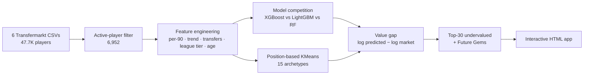

# ⚽ ScoutLens — ML-Based Football Player Valuation & Undervalued Talent Discovery

Predicts a player's fair market value from performance data and surfaces **undervalued players** — with a deliberate focus on talent outside the top leagues.

**🔴 Live demos:** [V2 — ML valuation app](https://serhattay1907.github.io/ScoutLens_ML_Project/scoutlens_ml_valuation.html) · [V1 — scouting dashboard](https://serhattay1907.github.io/ScoutLens_ML_Project/)

---

## 📊 Results (V2)
| Metric | Value |
|---|---|
| Raw player records | 47,701 (Transfermarkt, 6 CSVs) |
| Active players modelled | 6,952 |
| Best model | **XGBoost — R² 0.677** (log scale, held-out 20% test set; 5-fold CV for model selection) |
| Runner-ups | LightGBM 0.649 · Random Forest 0.645 |
| Improvement over V1 baseline | R² 0.047 → **0.677** |
| MAE | ≈ €3.1M |
| Top-30 undervalued list | 60% from Tier 2–3 leagues (target ≥ 60% ✅) |

## 🧠 Pipeline


**Key decisions**
- **Log-scale value gap** instead of raw % — prevents cheap players dominating the list
- **€100K market-value floor** to remove noise from inactive/amateur records
- **Dropped "highest market value"** as a feature — it leaks the target
- **Position-specific clustering** so archetypes compare like with like

## 🖥️ App features (V2)
Player Scout · Future Gems · Compare Players · Pipeline view · **AI Analyst** (Claude API, bring-your-own key — never stored, sent only to Anthropic's API)

## 🛠️ Stack
Python · pandas · NumPy · scikit-learn · XGBoost · LightGBM · KMeans · Matplotlib · Google Colab · HTML/CSS/JS · GitHub Pages

## 📁 Files
| File | Purpose |
|---|---|
| `ScoutLens_V2_ml_based_player_valuation.ipynb` | V2 pipeline (stages 1–9) |
| `scoutlens_ml_valuation.html` | V2 interactive app |
| `V1_football_valuation.ipynb` / `.py` | V1 baseline pipeline |
| `index.html` | V1 scouting dashboard (KMeans archetypes, radar charts) |

## 📦 Data
[Transfermarkt dataset on Kaggle](https://www.kaggle.com/datasets/davidcariboo/player-scores) — players, appearances, clubs, valuations, transfers.

## ▶️ Run
**Demos:** open either HTML file in a browser — the data is embedded, no setup needed.

**Pipeline (local):**
```bash
pip install -r requirements.txt
# needs a Kaggle API token: https://www.kaggle.com/docs/api
kaggle datasets download -d davidcariboo/player-scores -p data --unzip
jupyter notebook ScoutLens_V2_ml_based_player_valuation.ipynb
```
The notebook finds the CSVs in `./data`, the current folder, or `/content` (Colab).

## ⚠️ Limitations
- Transfermarkt market values are crowd-estimated, not transaction prices — the model learns the market's opinion, not ground truth.
- `transfer_fee_paid` is missing or zero for ~91% of active players, so it is a weak signal.
- Value gaps are computed from in-sample predictions for training-set players; out-of-fold predictions are planned for the next version.

---
**Author:** Serhat Tay


